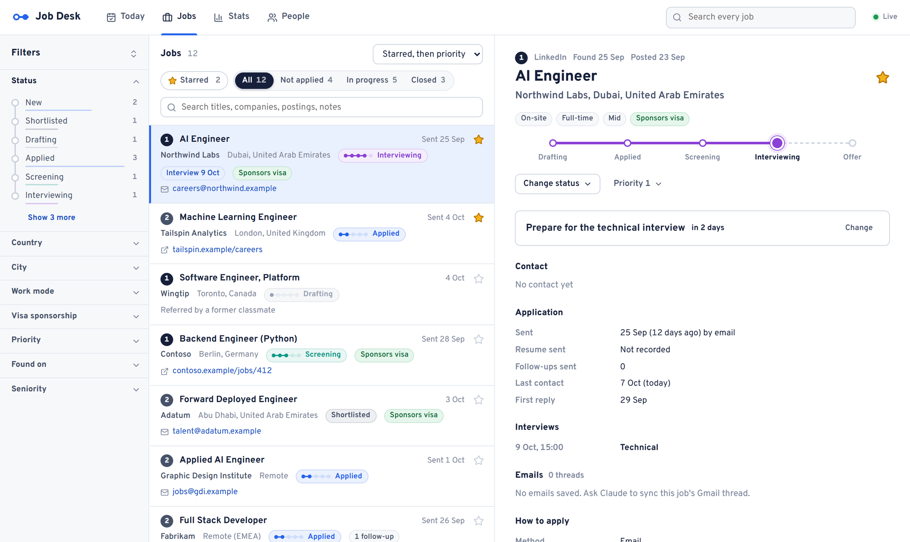

# Job Desk

[](https://m8ven.ai/mcp/shayaandanishansari-job-desk-15unee?s=readme)

A job-search tracker that runs on your own computer. Every job you're looking at or have applied to is one record: the posting, where the application stands, the emails, and what to do next. Freelance work gets the same treatment: every client project you're pitching for is one record too, from lead to won. There's a dashboard for you and an MCP server for Claude, and both work on the same database, so whatever Claude changes shows up on the dashboard within a second.

I built it for my own job search, after a folder of Markdown files and a status table stopped keeping up.



## Download

Windows: get **JobDesk-…-windows.zip** from [Releases](https://github.com/shayaandanishansari/job-desk/releases/latest), unzip it anywhere and double-click `JobDesk.exe`. The dashboard opens in your browser at http://127.0.0.1:8780. Keep the console window open while you use it, and close it to stop. No Python or Node needed.

Windows may say the app is from an unknown publisher, because it isn't code-signed. Choose **More info → Run anyway**.

Your data stays in `%APPDATA%\JobDesk`: the database, attached screenshots, backups and `settings.json`. Nothing leaves your computer. The server only listens on 127.0.0.1 and has no login. To update, replace the folder; the data isn't in it.

On macOS or Linux, [run it from source](#run-from-source).

## The dashboard

- **Today:** what's due across jobs and projects, replies waiting, drafts ready to send, interviews coming up, saved jobs closing soon, new jobs to look at and leads to pitch.
- **Jobs:** every job, with search and filters (status, country, city, work mode, visa, priority, source and more). The buttons above the list switch between All, Not applied, In progress and Closed. Each card's tag shows where the job stands: applied, rejected after a screening call, two follow-ups sent, and so on. Click a job to see the posting, its emails, interviews and history.
- **Stars:** click the star on any card to mark the jobs you care about. Starred jobs sort to the top.
- **Projects:** client work on a board, one lane per stage, from leads to won. Each card shows the price, the next step and when it's due. Click one to see the brief, the pitch, its emails and history.
- **Stats:** the funnel from applied to offer, broken down by source, country and resume version, plus applications per week. Switch to **Client work** for pitches, replies, proposals and wins, the open pipeline and what you've won.
- **People:** companies and contacts, shared by jobs and projects. A contact can have a role (recruiter, founder, client...).

A job moves `new → shortlisted → drafting → applied → screening → interviewing → offer`, and closes as rejected, role filled, no response (their side) or accepted, withdrew, declined (yours). Follow-ups are suggested 7 business days after applying and again 7 later, never more than two. After 30 days of silence it suggests closing the job as no response. It never moves a status on its own.

A project moves `lead → qualified → drafting → pitched → talking → proposal → negotiating`, and closes as won, turned down (yours) or lost, no response, cancelled (theirs). Pitches get follow-ups 3 and then 5 business days apart. Upwork proposals get none, since only the client can write first; after 14 days of silence it suggests closing them.

## Working with Claude

Job Desk includes an MCP server, so Claude can read and update your jobs. Every change it makes is validated, shows up live on the dashboard with a toast, and goes on the job's timeline.

With the download, add `JobDesk.exe mcp` as an MCP server. In Claude Code:

```powershell
claude mcp add jobdesk -- "C:\path\to\JobDesk\JobDesk.exe" mcp
```

In Claude Desktop, add this to `%APPDATA%\Claude\claude_desktop_config.json`:

```json
{
  "mcpServers": {
    "jobdesk": { "command": "C:\\path\\to\\JobDesk\\JobDesk.exe", "args": ["mcp"] }
  }
}
```

Running from source, Claude Code picks up `.mcp.json` in this folder on its own.

Things to ask:

- "Add this job", with a screenshot, pasted text or a link. Claude stores the posting word for word, attaches the screenshot and writes notes on fit.
- "Draft an application for #50." With a Gmail connector, Claude can save it to your Gmail drafts too.
- "Sync my Gmail." Claude reads your sent applications and replies and updates each job.
- "Add this Upwork job as a project", or "Add a lead: the dental clinic on Main Street." Claude stores the brief, the budget and who to talk to.
- "What's due?", "Which UAE jobs sponsor visas?", "Star the Acme one."

## Settings

`settings.json` sits next to the database (`%APPDATA%\JobDesk\settings.json`, or `data/settings.json` from source). Everything in it is optional. It's read on every use, so edits apply straight away.

```json
{
  "name": "Ada Lovelace",
  "email_addresses": ["ada@example.com"],
  "resumes": {
    "general": "C:/Users/ada/Resume/resume.pdf",
    "research": "C:/Users/ada/Resume/research.pdf"
  },
  "old_resumes": "C:/Users/ada/Resume/old",
  "email_guide": "C:/Users/ada/Documents/email-guide.md"
}
```

| Key | What it does |
|---|---|
| `name` | Whose job search this is. Claude's instructions use it. |
| `email_addresses` | Mail synced from these addresses counts as sent by you, not as a reply. The first one opens the "Open in Gmail" links. |
| `resumes` | The resumes you send now, one per variant. When you mark a job applied today, the first one's current build is recorded with it, and Stats compares how each version did. |
| `old_resumes` | A folder of past builds named `YYYY-MM-DD_<name>.pdf`, so older applications can point at the version they went out with. |
| `email_guide` | A Markdown file on how you write application emails: tone, what to include, links. Claude reads it before drafting one. |

## Run from source

You need Python 3.12+ and Node 20+.

```powershell
pip install -e ".[dev]"
cd web; npm ci; npm run build; cd ..
python -m jobdesk launch          # serves the dashboard on http://127.0.0.1:8780 and opens it
```

Data goes in `data/` in this folder. Set `JOBDESK_HOME` to keep it somewhere else.

Other commands: `python -m jobdesk today` prints what's due, `search <words>` searches jobs, and `backup <label>` copies the database into `backups/`.

## Development

```powershell
python -m jobdesk serve --reload    # API on 127.0.0.1:8780, restarts on code changes
cd web; npx vite                    # dashboard on 127.0.0.1:5180, hot reload
python -m pytest tests              # tests
cd web; npx tsc --noEmit            # type check
```

`start.ps1` starts both dev servers in their own windows and opens the dashboard. `AGENTS.md` has the details for coding agents: where things are, the rules for the data and how schema changes work.

The backend is FastAPI and SQLite, and the MCP server uses the official Python SDK. The dashboard is React, TypeScript and Vite. `core.py` is the only code that writes to the database, so the dashboard, Claude and the CLI all get the same validation, duplicate checks and timeline.

To build the Windows zip, run `packaging/build.ps1`. It makes its own clean Python environment in `.venv-build`, since PyInstaller bundles anything it can import. Pushing a tag like `v1.0.0` builds it on GitHub Actions and publishes a release.

## License

MIT
